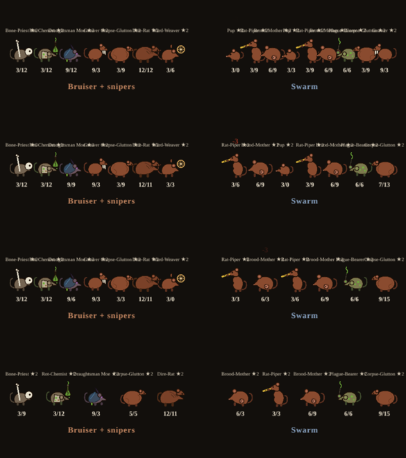

# Roster v3 review (branch `wt/v3`, not shipped)

Written 2026-11-17 for Jesper's return. Roster v2 is live (season 3, from
2026-11-16) and stays live until you decide.

## What v3 is

The same 13 rats as v2 on a different combat engine: **Battlegrounds-style
rounds** (`RULES.combat = 'bg'`, prototype from `wt/bg`, rebased onto live v2).
Instead of the two front rats trading blows each tick, each side's attackers
take turns, every attacker hits a random living enemy, and the target hits back.
Each side has its own seeded random stream, so duels stay seat-fair and
replayable.

Every rat gets a targeting role:

| Role | Rats | What it does |
|---|---|---|
| Taunt tank | Ward-Weaver | Enemies must hit it first (snipers excepted). |
| Sniper | Draughtsman Moe (hardest-hitting foe), Gnawer (weakest foe) | Ignores taunt. |
| Cleaver | Corpse-Glutton (attack 2 → 1) | Each hit also strikes the target's two neighbours. |
| Profits from random hits | Rat-Piper, Brood-Mother, Gutter Runt (bodies that soak random swings), Rot-Chemist (bursts on death), Bone-Priest (raises), Dire-Rat (armor), Plague-Bearer, Press-Kin, MD Rattyfock | Unchanged abilities; random targeting spreads damage over them. |

Only those five data lines change. The role fields act only in bg combat, so
queue combat (live) is untouched.

No new rats, so no new art. Every rat already has a portrait
(`packages/core/test/art.test.ts` passes).

## How the roles were chosen

The first try put taunt on Dire-Rat and cleave on MD Rattyfock. Bruiser then won
78% of late-week boards: taunt forces every enemy hit onto the rat with armor 2.
Eight variants were tried (duel-sim evolve, 3 seeds x 3 nights each). The one
kept moves taunt to Ward-Weaver (no armor) and cleave to Corpse-Glutton, with its
attack cut to 1.

## Sim: v3 against live v2

`npm run duel-sim -w @wrad/core -- evolve`, budgets 40 / 150 / 400 scrap (early,
mid, late week), 3 seeds x 3 nights, two independent seed sets.

**Fixed strategy matchups** (late week, 400 scrap; win rate of row against column;
stable across both seed sets):

| v2 (queue) | swarm | plague | sacrifice | bruiser |
|---|---|---|---|---|
| swarm | – | 0.00 | 1.00 | 0.00 |
| plague | 1.00 | – | 1.00 | 0.83 |
| sacrifice | 0.00 | 0.00 | – | 0.00 |
| bruiser | 1.00 | 0.17 | 1.00 | – |

| v3 (bg) | swarm | plague | sacrifice | bruiser |
|---|---|---|---|---|
| swarm | – | 0.00 | 1.00 | 0.00 |
| plague | 1.00 | – | 1.00 | 0.67 |
| sacrifice | 0.50 | 0.17 | – | 0.33 |
| bruiser | 1.00 | 0.67 | 0.83 | – |

In v2, sacrifice loses every matchup. In v3 every strategy wins something, and
bruiser can lose to sacrifice. That is the clearest gain.

**Evolved winning boards** (late week): noisy. On seed set 1, v3 had 12 of 13 rats
on winning boards (v2: 10) and strategies mixed 37 / plague 37 / bruiser 20 /
sacrifice 6. On seed set 2, both versions drift to about 60-70% bruiser. So: no
clear gain in late-week variety; the healthier matchups do not yet turn into
more varied winning boards.

**Fight length** (`scripts/combat-compare.ts`, maxed boards): **8.7 rounds**
per duel in v3 against **15.8** in v2 (max 13 against 20). Faster to watch.

**Raids** (waves cleared of 20, maxed boards): about the same. Swarm 11.0 (v2
12.0), plague 13.5 (13.8), sacrifice 9.4 (9.7), bruiser 16.8 (16.8).

**Seat fairness:** the bg tests (mirror draws, seat swap) pass; 229/229 core
tests pass.

## Replay at phone width

The bg duel plays without errors. Two problems before players could read it:

1. **Who hit whom is invisible.** The replay shows each attack as a short lunge
   between attacker and target. With random targets, a player cannot tell who
   attacked, or why everyone keeps hitting Ward-Weaver. It needs an attack line
   or arrow, and small role badges (taunt shield, sniper crosshair, cleave arc).
2. **Names overlap** with 7+ rats a side. This already happens in live v2.

## Recommendation: rework, then ship at a reset after you are back

- **Worth pursuing:** fights are about half as long, and the matchup table is
  healthier (no strategy loses everything, bruiser can lose).
- **Not ready:**
  - late-week winning boards still drift to bruiser, as in v2;
  - the replay cannot show targeting yet;
  - 14 queue-combat tests (golden logs, Ward-Weaver block timing, revive and
    relic tests) need porting before bg can be the default.
- **Next steps, in order:**
  1. Attack lines and role badges in the replay.
  2. One new rat that rewards random hits directly (e.g. "gains +1 attack when
     hit, max 3"), with art.
  3. Port the tests.
  4. Re-run the sim on 3+ seed sets.

## Running it

- Sim: `COMBAT=bg npm run duel-sim -w @wrad/core -- evolve`.
  - Live v2 for comparison: `COMBAT=queue`.
  - `SET` now also takes `rat.taunt=1`, `rat.cleave=1`, `rat.targeting=weakest|strongest`.
- App on bg combat: `VITE_COMBAT=bg npm run build -w @wrad/app`. Unset keeps live
  queue combat.
